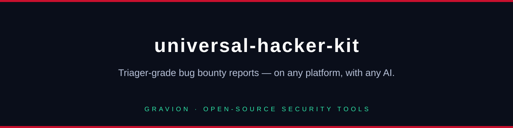

<p align="center"></p>

# universal-hacker-kit

[](https://github.com/gravion-ux/universal-hacker-kit/actions/workflows/ci.yml) [](LICENSE)

**Triager-grade bug bounty reports — on any platform, with any AI.**

A discipline kit for bug bounty hunters, built from a working hunter's
own method: **dedupe first, evidence only, lab-verified, scope-bound.**
It works for HackerOne, Bugcrowd, Intigriti, YesWeHack, Patchstack and
any other program, and because everything in it is plain markdown, it
works with Claude Code, ChatGPT, Cursor, Gemini CLI or any assistant
that can read a rules file.

Most hunters don't lose bounties on finding bugs. They lose them in
the last mile: a duplicate they didn't check, an impact section that
claims more than the PoC shows, a severity the scope page caps, a
report a triager can't replay. This kit exists to close that gap.

## Features

**An always-on discipline layer** — evidence rules, dedupe-first,
scope checks and testing guardrails, loaded at the start of every
session so they apply whether you're hunting, drafting or reviewing.

**Four skills:**

| Skill | Command (Claude Code) | What it does |
|---|---|---|
| Dedupe verifier | `/uhk:dedupe` | Five-source duplicate check (platform search, vendor changelog/patch diff, CVE databases, write-ups, your own history) with a CLEAR / LIKELY / CONFIRMED verdict — run *before* drafting |
| Report writing | `/uhk:write` | Report structure, per-section rules and per-platform field checks (HackerOne, Bugcrowd, Intigriti, YesWeHack, Patchstack) |
| Pre-submission triage | `/uhk:triage` | A strict 7-Question Gate plus scope, PoC and AI-slop passes; verdict READY / NEEDS WORK / DO NOT SUBMIT |
| Class gotchas | `/uhk:gotchas` | Minimum proof, automatic N/A traps and classic overclaims for 14 vulnerability classes |

## Install

### Claude Code

```
/plugin marketplace add gravion-ux/universal-hacker-kit
/plugin install uhk@universal-hacker-kit
```

The always-on rules activate through a bundled `SessionStart` hook
whose only command prints the kit's own `always-on-rules.md` into
context — no network, no writes, nothing else. Read it yourself in
`hooks/hooks.json`; delete that file if you prefer to copy the rules
into your `CLAUDE.md` manually.

### Any other AI

Copy `always-on-rules.md` into your assistant's project rules
(ChatGPT Project instructions, Cursor rules, a Gemini/Claude project
brief) and drop the `skills/` folders into your workspace. The skills
are plain markdown — invoke them by name ("run the dedupe skill on
this finding").

## How it works

1. **Find** the bug (your craft, your tools).
2. **`/uhk:dedupe`** — five checks, one verdict. A duplicate dies here,
   for free, instead of on the platform, at reputation cost.
3. **`/uhk:write`** — the report is built from your verified notes:
   summary, steps, raw PoC, demonstrated impact. Nothing invented,
   nothing padded.
4. **`/uhk:gotchas`** — the class section checks your claim against
   what triagers actually accept.
5. **`/uhk:triage`** — the gate. Seven questions, a slop pass, a
   verdict. Only READY reports get submitted.

## The method in one paragraph

Every finding is verified before it is written up — in a local lab
where the platform allows it. Every report is deduped against the
platform's own records, the vendor's paper trail, the CVE databases,
public write-ups and the hunter's own history. Impact is what the PoC
demonstrated, never what it suggests. Severity never exceeds the
program's cap. These rules were not written in the abstract; they are
the checklist behind a live hunting practice across five platforms.

## License

MIT — see `LICENSE`. Copyright © 2026 Priyanshu Kumar Thakur.

## Author

**Priyanshu Kumar Thakur (Gravion)** — security researcher & bug
bounty hunter focused on web applications, APIs and WordPress.

- Portfolio: https://gravion-ux.github.io/portfolio/
- GitHub: https://github.com/gravion-ux
